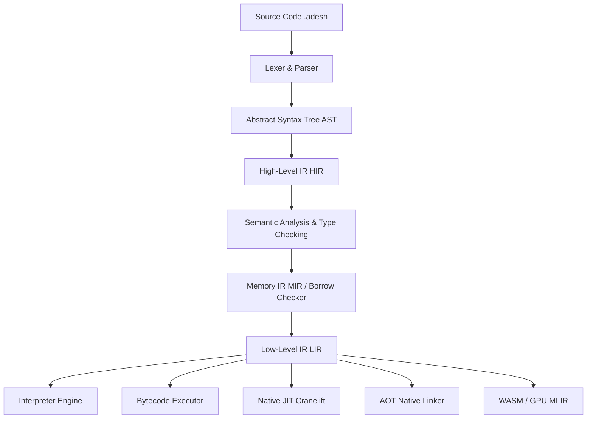

import FeatureStatus from '@site/src/components/FeatureStatus';

# AdeshLang Compiler Architecture

<FeatureStatus status="STABLE" details="Modular AST -> HIR -> MIR -> LIR -> CodeGen pipeline" />

The AdeshLang compiler is structured as a multi-stage compilation pipeline designed for high diagnostic clarity, memory safety verification, and execution backend flexibility.

## Compilation Pipeline

The pipeline transforms raw source text into machine code or intermediate representations through the following discrete stages:

## Compiler Stages & Implementation Mapping

| Pipeline Stage | Responsibilities | Source Path |
|---|---|---|
| **Lexer & Parser** | Tokenization, grammar validation, error recovery | [`src/parsing/parser`](file:///d:/Projects/AdeshLang/src/parsing/parser) |
| **AST** | Lossless abstract syntax representation | [`src/frontend`](file:///d:/Projects/AdeshLang/src/frontend) |
| **HIR** | Desugared control flow and resolved symbols | [`src/ir/hir`](file:///d:/Projects/AdeshLang/src/ir/hir) |
| **Semantic Checker** | Type inference, trait resolution, scopings | [`src/semantics`](file:///d:/Projects/AdeshLang/src/semantics) |
| **Borrow Checker** | Ownership tracking, CFG lifetime validation | [`src/parsing/cfg_borrow`](file:///d:/Projects/AdeshLang/src/parsing/cfg_borrow) |
| **MIR** | Ownership and move-annotated intermediate IR | [`src/ir/mir`](file:///d:/Projects/AdeshLang/src/ir/mir) |
| **LIR & Optimization** | SSA lowering, constant folding, dead code elimination, SIMD pass | [`src/ir/vir`](file:///d:/Projects/AdeshLang/src/ir/vir), [`src/ir/optimizations`](file:///d:/Projects/AdeshLang/src/ir/optimizations) |
| **CodeGen Backends** | Interpretation, bytecode, Cranelift native JIT, Cranelift AOT | [`src/backends/`](file:///d:/Projects/AdeshLang/src/backends) |

## Core Invariants

1. **Source of Truth Integrity**: Semantic analysis runs on desugared HIR before LIR lowering.
2. **Compile-Time Safety**: Borrow checking and move analysis reject illegal reference alias operations prior to code generation.
3. **Multi-Backend Portability**: LIR serves as the unified input for Interpreter, Bytecode VM, JIT, and AOT compilation targets.
