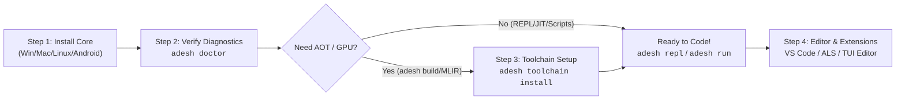

# Install AdeshLang

Official pre-built binaries, installers, and packages for **AdeshLang v0.3.1** are available for **Windows**, **macOS**, **Linux**, and **Android**.

---

## Direct Downloads (v0.3.1)

<div className="row">
  <div className="col col--6 margin-bottom--md">
    <div className="card shadow--md" style={{height: '100%'}}>
      <div className="card__header">
        <h3>🪟 Windows</h3>
      </div>
      <div className="card__body">
        <p>Supports Windows 10 & 11 (x86_64 & ARM64).</p>
        <ul>
          <li><strong>Setup Installer (x86_64)</strong>: Recommended GUI installer.</li>
          <li><strong>Portable ZIP</strong>: Zero-install standalone archive.</li>
        </ul>
      </div>
      <div className="card__footer">
        <a
          className="button button--primary button--block margin-bottom--sm"
          href="https://github.com/adeshlang/adeshlang/releases/download/v0.3.1/AdeshLang-0.3.0-x86_64-windows-setup.exe"
          target="_blank"
          rel="noopener noreferrer"
        >
          Download Windows Setup (.exe) — 70.4 MB
        </a>
        <div className="button-group button-group--block">
          <a
            className="button button--secondary button--sm"
            href="https://github.com/adeshlang/adeshlang/releases/download/v0.3.1/AdeshLang-0.3.0-x86_64-windows-portable.zip"
            target="_blank"
            rel="noopener noreferrer"
          >
            Portable x86_64 (.zip) — 120.3 MB
          </a>
          <a
            className="button button--secondary button--sm"
            href="https://github.com/adeshlang/adeshlang/releases/download/v0.3.1/AdeshLang-0.3.0-aarch64-windows-portable.zip"
            target="_blank"
            rel="noopener noreferrer"
          >
            Portable ARM64 (.zip) — 113.1 MB
          </a>
        </div>
      </div>
    </div>
  </div>

  <div className="col col--6 margin-bottom--md">
    <div className="card shadow--md" style={{height: '100%'}}>
      <div className="card__header">
        <h3>🍏 macOS</h3>
      </div>
      <div className="card__body">
        <p>Supports macOS 12 Monterey or newer (Apple Silicon & Intel).</p>
        <ul>
          <li><strong>Apple Silicon (M1/M2/M3/M4)</strong>: Native ARM64 build.</li>
          <li><strong>Intel (x86_64)</strong>: Native 64-bit Intel build.</li>
        </ul>
      </div>
      <div className="card__footer">
        <a
          className="button button--primary button--block margin-bottom--sm"
          href="https://github.com/adeshlang/adeshlang/releases/download/v0.3.1/AdeshLang-0.3.0-aarch64-macos.pkg"
          target="_blank"
          rel="noopener noreferrer"
        >
          Apple Silicon Installer (.pkg) — 21.2 MB
        </a>
        <div className="button-group button-group--block">
          <a
            className="button button--secondary button--sm"
            href="https://github.com/adeshlang/adeshlang/releases/download/v0.3.1/AdeshLang-0.3.0-aarch64-macos.dmg"
            target="_blank"
            rel="noopener noreferrer"
          >
            Apple Silicon (.dmg) — 23.6 MB
          </a>
          <a
            className="button button--secondary button--sm"
            href="https://github.com/adeshlang/adeshlang/releases/download/v0.3.1/AdeshLang-0.3.0-x86_64-macos.pkg"
            target="_blank"
            rel="noopener noreferrer"
          >
            Intel (.pkg) — 24.3 MB
          </a>
          <a
            className="button button--secondary button--sm"
            href="https://github.com/adeshlang/adeshlang/releases/download/v0.3.1/AdeshLang-0.3.0-x86_64-macos.dmg"
            target="_blank"
            rel="noopener noreferrer"
          >
            Intel (.dmg) — 27.6 MB
          </a>
        </div>
      </div>
    </div>
  </div>

  <div className="col col--6 margin-bottom--md">
    <div className="card shadow--md" style={{height: '100%'}}>
      <div className="card__header">
        <h3>🐧 Linux</h3>
      </div>
      <div className="card__body">
        <p>Native packages for Ubuntu/Debian, Fedora/RHEL, and standalone tarballs.</p>
        <ul>
          <li><strong>DEB</strong>: Ubuntu, Debian, Pop!_OS, Mint.</li>
          <li><strong>RPM</strong>: Fedora, RHEL, CentOS, Rocky, openSUSE.</li>
          <li><strong>Tarball (.tar.xz)</strong>: Universal standalone package.</li>
        </ul>
      </div>
      <div className="card__footer">
        <div className="button-group button-group--block margin-bottom--sm">
          <a
            className="button button--primary"
            href="https://github.com/adeshlang/adeshlang/releases/download/v0.3.1/adeshlang_0.3.0_amd64.deb"
            target="_blank"
            rel="noopener noreferrer"
          >
            Debian/Ubuntu x86_64 (.deb) — 90.7 MB
          </a>
          <a
            className="button button--primary"
            href="https://github.com/adeshlang/adeshlang/releases/download/v0.3.1/adeshlang_0.3.0_arm64.deb"
            target="_blank"
            rel="noopener noreferrer"
          >
            Debian/Ubuntu ARM64 (.deb) — 86.0 MB
          </a>
        </div>
        <div className="button-group button-group--block">
          <a
            className="button button--secondary button--sm"
            href="https://github.com/adeshlang/adeshlang/releases/download/v0.3.1/adeshlang-0.3.0-1.x86_64.rpm"
            target="_blank"
            rel="noopener noreferrer"
          >
            Fedora/RPM x86_64 — 117.5 MB
          </a>
          <a
            className="button button--secondary button--sm"
            href="https://github.com/adeshlang/adeshlang/releases/download/v0.3.1/AdeshLang-0.3.0-x86_64-linux-gnu.tar.xz"
            target="_blank"
            rel="noopener noreferrer"
          >
            Universal Tarball (.tar.xz) — 83.5 MB
          </a>
        </div>
      </div>
    </div>
  </div>

  <div className="col col--6 margin-bottom--md">
    <div className="card shadow--md" style={{height: '100%'}}>
      <div className="card__header">
        <h3>📱 Android</h3>
      </div>
      <div className="card__body">
        <p>AdeshLang Mobile IDE and native execution environment for Android devices.</p>
        <ul>
          <li><strong>ARM64-v8a APK</strong>: Recommended for physical devices.</li>
          <li><strong>Universal APK</strong>: Compatible with all 64-bit architectures.</li>
        </ul>
      </div>
      <div className="card__footer">
        <a
          className="button button--primary button--block margin-bottom--sm"
          href="https://github.com/adeshlang/adeshlang/releases/download/mobile-v0.3.0/AdeshLang-mobile-0.3.0-arm64-v8a.apk"
          target="_blank"
          rel="noopener noreferrer"
        >
          Download Android APK (ARM64) — 62.2 MB
        </a>
        <div className="button-group button-group--block">
          <a
            className="button button--secondary button--sm"
            href="https://github.com/adeshlang/adeshlang/releases/download/mobile-v0.3.0/AdeshLang-mobile-0.3.0-universal.apk"
            target="_blank"
            rel="noopener noreferrer"
          >
            Universal APK (134 MB)
          </a>
          <a
            className="button button--secondary button--sm"
            href="https://github.com/adeshlang/adeshlang/releases/download/mobile-v0.3.0/AdeshLang-mobile-0.3.0-x86_64.apk"
            target="_blank"
            rel="noopener noreferrer"
          >
            x86_64 Emulator (73.5 MB)
          </a>
        </div>
      </div>
    </div>
  </div>

  <div className="col col--12 margin-bottom--md">
    <div className="card shadow--md" style={{height: '100%'}}>
      <div className="card__header">
        <h3>💻 Visual Studio Code Extension</h3>
      </div>
      <div className="card__body">
        <p>Official AdeshLang Language Support &amp; ALS Language Server integration for VS Code and VS Code-based editors (Cursor, Windsurf, VSCodium).</p>
        <ul>
          <li>Full ALS Language Server protocol integration with live diagnostic checks.</li>
          <li>Semantic syntax highlighting, auto-completion, hover docs, and formatting.</li>
        </ul>
      </div>
      <div className="card__footer">
        <a
          className="button button--primary button--block margin-bottom--sm"
          href="https://github.com/adeshlang/adeshlang/releases/download/vscode-v0.3.0/adesh-vscode-0.3.0.vsix"
          target="_blank"
          rel="noopener noreferrer"
        >
          Download VS Code Extension (.vsix) — 11.11 MB
        </a>
      </div>
    </div>
  </div>
</div>

---

## All Release Assets & SHA-256 Checksums

All official packages and binaries are cryptographically signed and checksummed in the [AdeshLang Releases](https://github.com/adeshlang/adeshlang/releases).

| File Name | Platform / Target | Size | SHA-256 Checksum |
|---|---|---|---|
| **[adesh-editor.exe](https://github.com/adeshlang/adeshlang/releases/download/v0.3.1/adesh-editor.exe)** | Windows x86_64 TUI Code Editor | 2.72 MB | `34245fb92b2f2270909b5be0aa8fb5266a6452d1ed61cb59b07e57013f5fb06e` |
| **[adesh-observatory-desktop.exe](https://github.com/adeshlang/adeshlang/releases/download/v0.3.1/adesh-observatory-desktop.exe)** | Release Artifact | 12.7 MB | `5fdad45bb621b4d9441f9e34655b506b688ddc4de4413c94ff42cae7e13add48` |
| **[adesh.exe](https://github.com/adeshlang/adeshlang/releases/download/v0.3.1/adesh.exe)** | Windows x86_64 Standalone CLI | 32.7 MB | `cdd99405f5405e8f69c6918431250e00acb08bfc00df7db502cc627f290077d1` |
| **[AdeshLang-0.3.0-aarch64-windows-portable.zip](https://github.com/adeshlang/adeshlang/releases/download/v0.3.1/AdeshLang-0.3.0-aarch64-windows-portable.zip)** | Windows ARM64 (Portable ZIP) | 42.6 MB | `68cbfa14fcee633eda7c465db6879a1fdead34519ec24919aff38513b0ed2708` |
| **[AdeshLang-0.3.0-x86_64-windows-portable.zip](https://github.com/adeshlang/adeshlang/releases/download/v0.3.1/AdeshLang-0.3.0-x86_64-windows-portable.zip)** | Windows x86_64 (Portable ZIP) | 46.7 MB | `56ffee47115131baf1921e8c126b53b63529d71913308d5d7fb7469068f54c7c` |
| **[AdeshLang-0.3.0-x86_64-windows-setup.exe](https://github.com/adeshlang/adeshlang/releases/download/v0.3.1/AdeshLang-0.3.0-x86_64-windows-setup.exe)** | Windows x86_64 (Setup GUI) | 18.6 MB | `90f6c0f21a88abb50e563eade2831fb754d17308efc34fa5ceed8a4a5671097f` |
| **[adeshlink.exe](https://github.com/adeshlang/adeshlang/releases/download/v0.3.1/adeshlink.exe)** | Release Artifact | 3.67 MB | `853741ced4c41ba938c2ce6c64bb6749d1d7a92b898a59970f8a4bd40a816558` |
| **[adl.exe](https://github.com/adeshlang/adeshlang/releases/download/v0.3.1/adl.exe)** | Windows x86_64 Package Manager | 3.32 MB | `daa6152755f206936371575e952386f5a6865e906e9fa17cb887a2516414e002` |
| **[als.exe](https://github.com/adeshlang/adeshlang/releases/download/v0.3.1/als.exe)** | Windows x86_64 Language Server | 4.64 MB | `e1df4b799bb4319f30cca21a83c473bf3fe48c86a270743de6d76a3c4ebb5310` |
| **[aro.exe](https://github.com/adeshlang/adeshlang/releases/download/v0.3.1/aro.exe)** | Release Artifact | 2.06 MB | `d3a94b3062253c845fe1f90b56c1783df64123ef376df0bfbbba54fc7432817d` |
| **[install-windows.ps1](https://github.com/adeshlang/adeshlang/releases/download/v0.3.1/install-windows.ps1)** | Release Artifact | 3.92 KB | `5ed23b53dee02237623433c315d04b792d63d51a47d3cb52333186d234ed9f48` |
| **[SHA256SUMS](https://github.com/adeshlang/adeshlang/releases/download/v0.3.1/SHA256SUMS)** | All Checksums File | 1.34 KB | `2385836a505c43245df1ea40b99ccc9bafa1f6ec7b10137b2809155a30132c68` |
| **[toolchain-manifest.json](https://github.com/adeshlang/adeshlang/releases/download/v0.3.1/toolchain-manifest.json)** | LLVM Toolchain Resolver Manifest | 4.14 KB | `c90ac73985bfe49c0d89d9e6d7dc4ed5ed67d952732ff9a82f511db572678699` |
| **[AdeshLang-mobile-0.3.0-arm64-v8a.apk](https://github.com/adeshlang/adeshlang/releases/download/mobile-v0.3.0/AdeshLang-mobile-0.3.0-arm64-v8a.apk)** | Android ARM64-v8a (Recommended APK) | 62.7 MB | `43ef6e42aa3235322b659e71f2a6b942b75cea004477c8177264ea1ff505f296` |
| **[AdeshLang-mobile-0.3.0-universal.apk](https://github.com/adeshlang/adeshlang/releases/download/mobile-v0.3.0/AdeshLang-mobile-0.3.0-universal.apk)** | Android Universal (All-in-One APK) | 135.4 MB | `094fd787e32a573bd0a694288d7ba24ea7ceec38485a1fe747ccf5f1c4550928` |
| **[AdeshLang-mobile-0.3.0-x86_64.apk](https://github.com/adeshlang/adeshlang/releases/download/mobile-v0.3.0/AdeshLang-mobile-0.3.0-x86_64.apk)** | Android x86_64 (Emulators / ChromeOS) | 74.1 MB | `278b048fc55e6317240f9992c2da6e39fb5970a4a2144fcfa63e694aaf2ca0f5` |
| **[AdeshLang-mobile-0.3.0.aab](https://github.com/adeshlang/adeshlang/releases/download/mobile-v0.3.0/AdeshLang-mobile-0.3.0.aab)** | Android App Bundle (AAB Package) | 107.4 MB | `b6453465967f1b69c53b8e1079d2c14f06d2afeb1bdc2e096c64163cccd61b10` |
| **[SHA256SUMS-mobile.txt](https://github.com/adeshlang/adeshlang/releases/download/mobile-v0.3.0/SHA256SUMS-mobile.txt)** | Release Artifact | 306 B | `5475d870f08bc0381450cd05e519017aeb110ebb40272d78dfc289720eaa72ad` |
| **[adesh-vscode-0.3.0.vsix](https://github.com/adeshlang/adeshlang/releases/download/vscode-v0.3.0/adesh-vscode-0.3.0.vsix)** | VS Code Extension (VSIX Package) | 1.11 MB | `8394d41f2772a782f25405408916e56b64d871ab087e8d7bfeb6187363257d59` |

---

---

## Installation & Toolchain Setup Flow

Follow this 4-step flow to set up AdeshLang on your system, verify diagnostics, configure optional toolchains, and begin coding.



---

### Step 1: Install AdeshLang Core Package

Download and install the official package for your platform using the [Direct Downloads](#direct-downloads-v030) or [Platform-Specific Instructions](#installation-instructions) below:

* **🪟 Windows**: Run `AdeshLang-0.3.0-x86_64-windows-setup.exe` (or extract portable ZIP).
* **🍏 macOS**: Run `AdeshLang-0.3.0-*.pkg` or open `.dmg`.
* **🐧 Linux**: Install `adeshlang_0.3.0_amd64.deb` (`sudo dpkg -i ...`) or `adeshlang-0.3.0-1.x86_64.rpm`.
* **📱 Android**: Sideload `AdeshLang-mobile-0.3.0-arm64-v8a.apk`.

:::tip Out-of-the-Box Execution (Zero External Dependencies)
AdeshLang's core features run immediately after Step 1 with **zero external dependencies**:
* **`adesh repl`** — Interactive REPL shell.
* **`adesh run <file.adesh>`** — Tree-walk bytecode interpreter.
* **`adesh run --njit <file.adesh>`** — Ultra-fast Cranelift Native JIT engine (10× to 230× speedup).
* **`adesh check` & `adesh fmt`** — Static analysis, borrow-checker, and formatting.
* **`als` / `adesh lsp`** — Language server for real-time IDE diagnostics.
:::

---

### Step 2: Verify Environment & Diagnostics

After installing, verify the binaries and run the automated health check:

```bash
# Verify CLI is on PATH
adesh --version

# Run full system diagnostics (compilers, JIT runtime, GPU drivers, AI acceleration)
adesh doctor

# Inspect environment variables and resolved paths
adesh env
adesh env --json
```

---

### Step 3: Toolchain Setup (`adesh toolchain install`) *(Optional)*

The optional LLVM/MLIR toolchain is only required if you plan to use **AOT static compilation** (`adesh build <file.adesh>`) or **GPU MLIR kernels**. 

```bash
# Recommended on Linux (Ubuntu/Debian/Fedora/Arch) & macOS (Homebrew):
# Installs and registers native toolchain via your system package manager (apt/dnf/pacman/brew)
adesh toolchain install --use-system-packages

# Automated download & installation of pinned upstream toolchain:
adesh toolchain install

# For pre-release builds or custom environments:
adesh toolchain install --allow-unverified

# Install system-wide (requires admin / sudo):
sudo adesh toolchain install --system
```

#### Toolchain Diagnostics & Management Commands

| Command | Purpose |
|---|---|
| `adesh toolchain current` | Display the active toolchain path, Clang, and LLD linker locations. |
| `adesh toolchain list` | List bundled and system-detected LLVM/MLIR toolchains. |
| `adesh toolchain check` | Verify whether the active toolchain can compile native targets. |
| `adesh toolchain path` | Print the path to the bundled toolchain root directory. |
| `adesh toolchain expose --system` | Expose bundled LLVM/Clang tools system-wide for third-party programs. |

---

### Step 4: Editor & Developer Workflow Setup

#### 💻 VS Code / Cursor / Windsurf
Install the official extension for syntax highlighting, autocomplete, code actions, and real-time ALS diagnostics:
```bash
# Download and install VSIX
curl -LO https://github.com/adeshlang/adeshlang/releases/download/vscode-v0.3.0/adesh-vscode-0.3.0.vsix
code --install-extension adesh-vscode-0.3.0.vsix
```

#### 🖥️ Built-in Terminal UI (TUI) Editor
AdeshLang includes a complete terminal-based code editor built-in. Launch it anytime without needing an external IDE:
```bash
adesh editor           # Launch TUI editor
adesh-editor main.adesh # Edit specific file in TUI editor
```

#### 🐳 Docker Container Quickstart
If you prefer running AdeshLang in a fully isolated container with LLVM/MLIR and native toolchains pre-configured:
```bash
# Pull and start interactive REPL
docker run -it --rm adeshlang/adeshlang:latest adesh repl

# Execute local scripts inside container
docker run -it --rm -v "$(pwd):/app" adeshlang/adeshlang:latest adesh run /app/main.adesh
```

---

### Essential Adesh Command Reference

| Command | Category | Description & Usage |
|---|---|---|
| `adesh doctor` | **Diagnostics** | Run complete health check on compiler, backends, environment, and AI hardware acceleration drivers. |
| `adesh toolchain install` | **Toolchain** | Provision, download, or bind LLVM, Clang, LLD, and MLIR native compilation backends. |
| `adesh toolchain current` | **Toolchain** | Inspect the active compiler backend, sysroot, and tool locations. |
| `adesh repl` | **Execution** | Launch the interactive AdeshLang REPL shell with multiline support. |
| `adesh run <file.adesh>` | **Execution** | Execute AdeshLang source with the standard tree-walk interpreter. |
| `adesh run --njit <file>` | **Execution** | Execute using **Cranelift Native JIT** backend (10× to 230× speedups). |
| `adesh build <file.adesh>` | **Compilation** | AOT compile source into standalone native machine binary. |
| `adesh editor` | **IDE Tool** | Launch the built-in cross-platform Terminal UI (TUI) Code Editor. |
| `adesh check <file.adesh>` | **Linter** | Run static analysis, type checking, and borrow checker without codegen. |
| `adesh fmt <file.adesh>` | **Formatter** | Auto-format source files according to standard AdeshLang style guidelines. |
| `adesh lsp` / `als` | **Language Server** | Launch the Adesh Language Server for VS Code, Cursor, and Windsurf integration. |
| `adl install <pkg>` | **Package Mgr** | Install dependencies, libraries, or AI/ML model binding packages. |

---

## Installation Instructions

### 🪟 Windows Installation

#### Graphical Setup (Recommended)
1. Download **[AdeshLang-0.3.0-x86_64-windows-setup.exe](https://github.com/adeshlang/adeshlang/releases/download/v0.3.1/AdeshLang-0.3.0-x86_64-windows-setup.exe)**.
2. Run the installer and follow the on-screen prompts.
3. Open PowerShell or Command Prompt and verify:
   ```powershell
   adesh --version
   adesh doctor
   ```

#### Portable ZIP Archive
1. Download **[AdeshLang-0.3.0-x86_64-windows-portable.zip](https://github.com/adeshlang/adeshlang/releases/download/v0.3.1/AdeshLang-0.3.0-x86_64-windows-portable.zip)**.
2. Extract the archive to your preferred directory (e.g. `C:\AdeshLang`).
3. Add the `bin` directory to your user `PATH`.

---

### 🍏 macOS Installation

#### PKG Installer (Recommended)
1. Download the PKG installer for your architecture:
   - **Apple Silicon (M1/M2/M3/M4)**: [AdeshLang-0.3.0-aarch64-macos.pkg](https://github.com/adeshlang/adeshlang/releases/download/v0.3.1/AdeshLang-0.3.0-aarch64-macos.pkg)
   - **Intel**: [AdeshLang-0.3.0-x86_64-macos.pkg](https://github.com/adeshlang/adeshlang/releases/download/v0.3.1/AdeshLang-0.3.0-x86_64-macos.pkg)
2. Double-click the `.pkg` file and follow the standard macOS installation wizard.
3. Open Terminal and run:
   ```bash
   adesh --version
   adesh doctor
   ```

#### DMG Drag-and-Drop
1. Download the `.dmg` image ([Apple Silicon DMG](https://github.com/adeshlang/adeshlang/releases/download/v0.3.1/AdeshLang-0.3.0-aarch64-macos.dmg) / [Intel DMG](https://github.com/adeshlang/adeshlang/releases/download/v0.3.1/AdeshLang-0.3.0-x86_64-macos.dmg)).
2. Open the image and double-click `Install-AdeshLang.command` or copy to `/Library/Application Support/AdeshLang`.

---

### 🐧 Linux Installation

#### Debian / Ubuntu / Mint / Pop!_OS (.deb)
```bash
# Download DEB package
curl -LO https://github.com/adeshlang/adeshlang/releases/download/v0.3.1/adeshlang_0.3.0_amd64.deb

# Install via dpkg / apt
sudo dpkg -i adeshlang_0.3.0_amd64.deb
sudo apt-get install -f  # resolve any dependencies if needed

# Verify
adesh --version
adesh doctor
```

#### Fedora / RHEL / Rocky / CentOS (.rpm)
```bash
# Download and install RPM
sudo rpm -Uvh https://github.com/adeshlang/adeshlang/releases/download/v0.3.1/adeshlang-0.3.0-1.x86_64.rpm

# Verify
adesh --version
adesh doctor
```

#### Universal Tarball (.tar.xz) — 83.5 MB
```bash
# Download and extract tarball
curl -LO https://github.com/adeshlang/adeshlang/releases/download/v0.3.1/AdeshLang-0.3.0-x86_64-linux-gnu.tar.xz
tar -xf AdeshLang-0.3.0-x86_64-linux-gnu.tar.xz

# Move to local bin or export PATH
sudo cp -r AdeshLang-0.3.0-x86_64-linux-gnu/* /usr/local/
```

---

### 💻 Visual Studio Code Extension (.vsix)

The official **AdeshLang VS Code Extension** integrates syntax highlighting, autocomplete, code actions, and real-time ALS language server diagnostics for VS Code, Cursor, Windsurf, and VSCodium.

#### Option 1: Install via VS Code Command Line (CLI)
```bash
# Download the VSIX package
curl -LO https://github.com/adeshlang/adeshlang/releases/download/vscode-v0.3.0/adesh-vscode-0.3.0.vsix

# Install into VS Code
code --install-extension adesh-vscode-0.3.0.vsix
```

#### Option 2: Install via VS Code Graphical Interface
1. Download **[adesh-vscode-0.3.0.vsix](https://github.com/adeshlang/adeshlang/releases/download/vscode-v0.3.0/adesh-vscode-0.3.0.vsix)**.
2. In VS Code, open the Extensions view (`Ctrl+Shift+X` on Windows/Linux or `Cmd+Shift+X` on macOS).
3. Click the `...` menu (Views and More Actions) at the top-right of the Extensions pane.
4. Select **Install from VSIX...**
5. Select the downloaded `adesh-vscode-0.3.0.vsix` file to install.

---

### 📱 Android Installation

The **AdeshLang Mobile App** is a standalone code editor and native Adesh runtime environment for Android smartphones, tablets, and emulators.

#### Option 1: Direct Download & Sideload (Phone / Tablet)
1. Download the **[ARM64-v8a APK](https://github.com/adeshlang/adeshlang/releases/download/mobile-v0.3.0/AdeshLang-mobile-0.3.0-arm64-v8a.apk)** on your Android device (or use the **[Universal APK](https://github.com/adeshlang/adeshlang/releases/download/mobile-v0.3.0/AdeshLang-mobile-0.3.0-universal.apk)**).
2. Open the downloaded `.apk` file.
3. If prompted, enable **"Install unknown apps"** in your Android Settings for your browser or file manager.
4. Tap **Install** and launch AdeshLang Mobile.

#### Option 2: Install via Android Debug Bridge (ADB)
```bash
# Download the ARM64 APK
curl -LO https://github.com/adeshlang/adeshlang/releases/download/mobile-v0.3.0/AdeshLang-mobile-0.3.0-arm64-v8a.apk

# Install to connected device via ADB
adb install AdeshLang-mobile-0.3.0-arm64-v8a.apk
```

---

## Verifying Integrity

You can verify the integrity of any downloaded package using the official `SHA256SUMS` file:

```bash
# Linux / macOS
curl -sL https://github.com/adeshlang/adeshlang/releases/download/v0.3.1/SHA256SUMS | grep "<filename>" | sha256sum -c

# Windows PowerShell
Get-FileHash -Algorithm SHA256 .\AdeshLang-0.3.0-x86_64-windows-setup.exe
```
