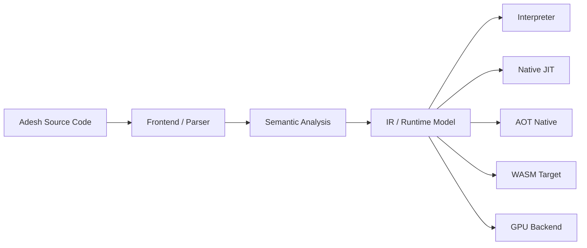

# Welcome to Adesh

<div align="center">
  
</div>

**Command. Code. Create.**

**Adesh** — meaning command, instruction, direction, and guidance.

Adesh is a modern systems-and-applications language designed around one simple idea: turn command into code and create meaningful software with clarity, power, and purpose. It blends readability, static safety, and high-performance backends into a single language model.

> Adesh is not just another scripting language. It is a language for developers who want expressive syntax, predictable performance, and backend flexibility without sacrificing correctness.

:::warning Experimental Language Notice
**Adesh is currently an Experimental Programming Language.** Features, APIs, and syntax are evolving as we refine language ergonomics and compiler architectures.
:::

:::note Primary Execution Backend & Source of Truth
The **Tree-Walk Interpreter** is currently the **main reference implementation** and reflection of Adesh. It represents the authoritative source of truth for language behavior, semantics, and standard library execution.

Other execution targets — **Cranelift Native JIT**, **AOT Native Compilation**, **WASM**, and a **GPU** backend planned for a future release — are under **active development** (`EXPERIMENTAL` / `PARTIAL` status).
:::

:::tip Built with Rust & Community Shoutout
🦀 **Built with Rust**: The Adesh compiler toolchain, lexer, parser, AST representation, and runtime systems are crafted in **Rust**.

A huge **shoutout and heartfelt thank-you** to the **Rust Core Team**, the **Rust Foundation**, and the entire **Rust Community**! Rust's zero-cost abstractions, fearless concurrency, memory safety, and incredible ecosystem (including crates like `cranelift`, `rustyline`, and `clap`) made building a modern language compiler possible.
:::

## Purpose of the language

Adesh was created to make programming more intentional and approachable. Its purpose is to help developers command machines with clean logic, write robust code with safety in mind, and create tools, apps, and systems that scale from simple scripts to serious software projects.

It brings together the discipline of systems programming with the creativity of modern application development.

## About the creator

Adesh was created by **Ajay Tainwala**, a developer driven by the idea that programming should be both powerful and human-friendly. The language reflects a vision of building software that is expressive, reliable, and deeply useful in real-world development.

## Made in India

Adesh is proudly rooted in **India** — inspired by the spirit of innovation, resilience, and craftsmanship that comes from one of the world’s oldest and most vibrant knowledge traditions. It represents a modern technology vision built with Indian creativity and global ambition.

---

## Why Adesh exists

Most languages optimize for one dimension: either ease of learning, runtime speed, or safety. Adesh tries to balance all three.

- It is designed to feel clean and approachable for beginners.
- It gives you strong typing and compile-time checks for large programs.
- It supports several execution models so a single program can run with different performance tradeoffs.
- It aims to be practical across scripting, CLI tools, server code, math-heavy workloads, and compiled binaries.

This makes it useful both as a teaching language and as a serious implementation target for real-world software.

---

## The philosophy behind the language

### 1. Clear instructions
The language name itself reflects the core idea: a program is a set of precise instructions. Adesh prefers explicit code over hidden behavior.

### 2. Safety by default
Memory safety, ownership awareness, and clear type rules are central. The compiler and runtime work together to catch mistakes early.

### 3. Performance with flexibility
A program should not be locked into one execution strategy. Adesh can run through an interpreter, native JIT, AOT native compilation, WASM, or a GPU-oriented pipeline planned for a future release.

### 4. Progressive learning curve
A beginner should be able to write a simple script quickly, while an advanced developer should still be able to work on performance-critical systems and compiler-related features.

---

## Core language goals

### Learnability
The syntax is intentionally readable and close to natural expression. Basic code should be understandable even to someone new to programming.

### Reliability
Static types, explicit rules, and compile-time checks reduce common runtime errors.

### Expressiveness
Adesh supports functions, control flow, collections, objects, generics, async patterns, and more advanced features like pattern matching and decorators.

### Portability
One source language can be deployed with different backends for local execution, web deployment, or optimized native delivery.

---

## High-level architecture

Adesh separates the source language from the execution model.



This makes the language more modular: the same program can be interpreted quickly for development, compiled for production, or adapted to specialized hardware.

---

## Execution backends at a glance

| Backend | Best for | Characteristics |
|---|---|---|
| Interpreter | Learning, prototyping, debugging | Fast startup, flexible behavior |
| Native JIT | Long-running compute | Runtime native code generation |
| AOT Native Compilation | Production binaries | Optimized standalone executables |
| WASM | Browser and edge deployment | Portable sandboxed execution |
| GPU (planned) | Parallel tasks and acceleration | Specialized hardware targeting |

This backend model is one of Adesh’s defining strengths.

---

## A first example

```adesh
fn greet(name: string) {
    print("Hello, ", name, "!");
}

fn main() {
    let user = "World";
    greet(user);

    for i in 1..5 {
        print("Count: ", i);
    }
}
```

This example shows the language’s core character:

- a simple function declaration
- a typed parameter
- local variables with `let`
- direct iteration with a range
- clear console output

---

## The mental model

A new Adesh program usually follows this pattern:

1. Declare data with variables or constants.
2. Define functions to structure logic.
3. Control execution with conditionals and loops.
4. Use collections and objects to model real data.
5. Compile or run the program through the desired backend.

This approach is familiar to developers from many languages, but Adesh adds a strong emphasis on explicitness and performance-aware design.

---

## Where to go next

Pick the path that matches what you want to do right now:

| If you want to... | Go to... |
|-------------------|----------|
| **Learn programming from zero** | [Learn](/learn) — guided roadmap |
| **Run your first program in 5 minutes** | [Quick Start](/learn/getting-started/quick-start) |
| **See complete, runnable programs** | [Learn by Examples](/learn-by-examples) |
| **Understand the language deeply** | [Language Guide](/docs/language-guide/basics) |
| **Explore execution backends** | [Backends Overview](/docs/backends/overview) |
| **See how the compiler works** | [Compiler Architecture](/docs/compiler/overview) — from lexer to codegen |
| **Look up the standard library** | [Stdlib Overview](/docs/builtin/overview) |
| **Contribute to Adesh** | [Contributing Guide](/docs/contributing) |
| **Get a question answered** | [FAQ](/docs/faq) |

---

## Community and resources

- GitHub repository: [github.com/adeshlang/adeshlang](https://github.com/adeshlang/adeshlang)
- Issue tracker: [GitHub Issues](https://github.com/adeshlang/adeshlang/issues)
- Standard library docs: [Builtins and modules](/docs/builtin/overview)
- Performance and optimizer guides: [Performance](/docs/performance/optimization)

Welcome to the language. The best way to understand it is to build with it.

---

*"Adesh" — Give the command. The machine obeys. The possibilities are infinite.* 🚀